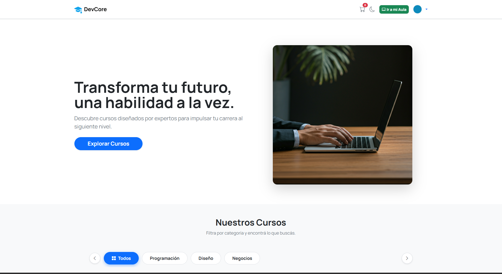
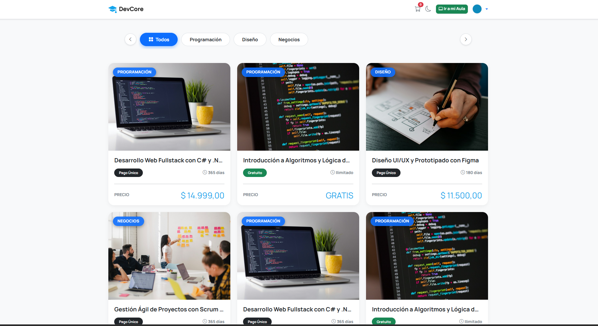
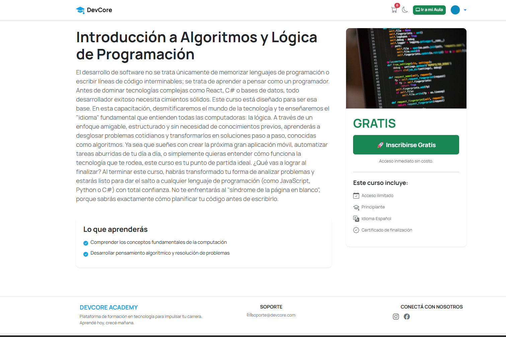
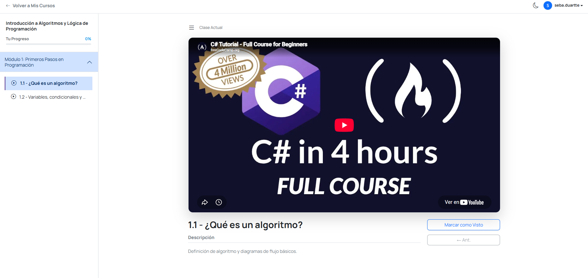
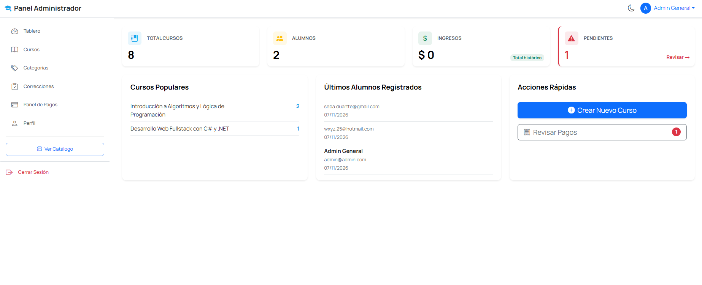
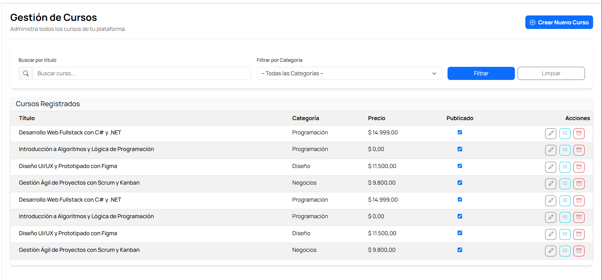
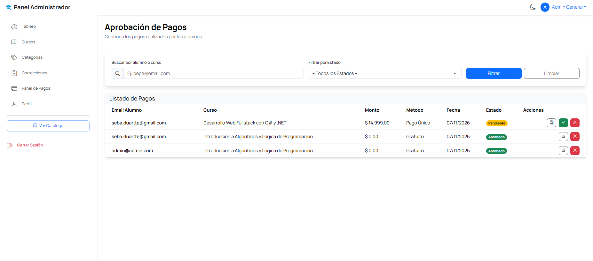
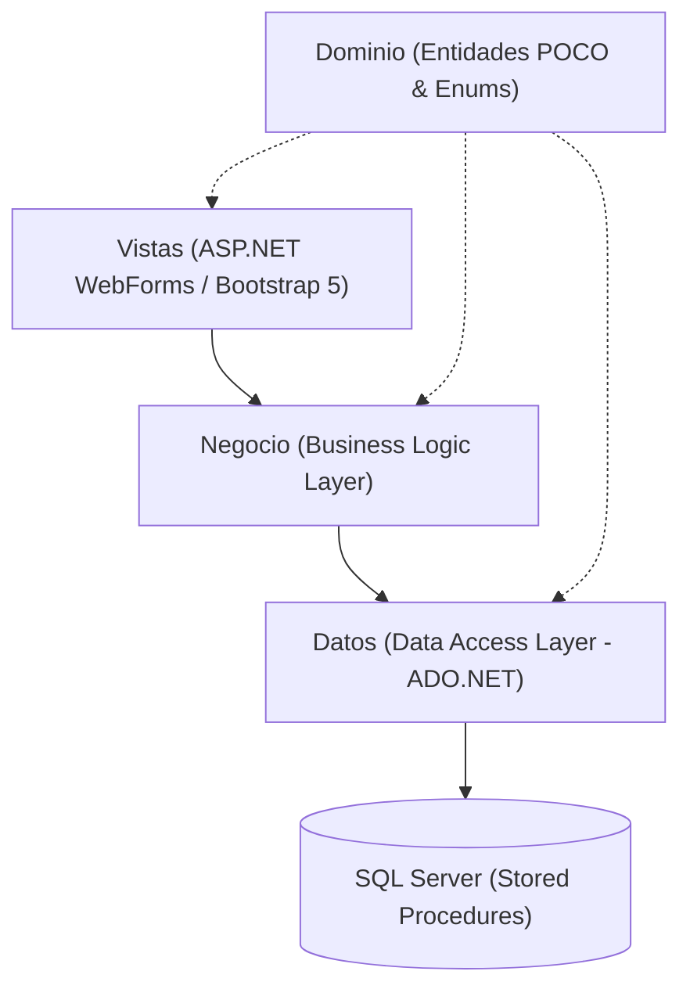

# 🎓 DevCore Academy - Plataforma LMS Fullstack

<div align="center">


-blue?style=for-the-badge)

<br/>

**Plataforma integral de gestión de cursos online (Learning Management System) de alto rendimiento.**  
Diseñada y construida siguiendo las mejores prácticas de la ingeniería de software con arquitectura en 4 capas (*N-Tier*), persistencia con ADO.NET y Stored Procedures, seguridad criptográfica con PBKDF2 y un flujo de negocio completo de comercialización, cursado, exámenes y certificación.

</div>

---

## 📸 Recorrido Visual de la Plataforma

### 👨‍🎓 Experiencia del Estudiante (Portal Público y Aula Virtual)

#### 1. Página de Inicio y Catálogo Dinámico
Exploración de la oferta académica con filtrado en tiempo real por categorías, badges de estado, precios y fichas técnicas.





#### 2. Detalle y Ficha Técnica del Curso
Información detallada, objetivos pedagógicos, temario modular organizado y opciones de inscripción.



#### 3. Aula Virtual Interactiva
Experiencia de aprendizaje con reproductor multimedia adaptativo (videos integrados), barra de progreso dinámica por lección completada y navegación secuencial por módulos.



---

### 👮‍♂️ Experiencia Administrativa (Backoffice & Gestión)

#### 4. Dashboard de Métricas y Control
Panel de mando integral con métricas en tiempo real: ingresos totales, alumnos matriculados, pagos pendientes y cursos activos.



#### 5. Gestión Integral de Cursos (ABM Jerárquico)
Manejo exhaustivo del ciclo de vida de los contenidos educativos: creación y edición de Cursos, Módulos jerárquicos y Lecciones multimedia.



#### 6. Gestión Financiera y Validación de Pagos
Bandeja de verificación de pagos con inspección de comprobantes adjuntos, aprobación/rechazo en un clic y activación automática de matrículas.



---

## 🏛️ Arquitectura del Sistema (N-Tier)

El proyecto se diseñó bajo una estricta separación de responsabilidades para garantizar mantenibilidad, testabilidad y escalabilidad:



- **`Dominio` (Entities & Enums):** Modelos de datos puros (POCOs) y enumeraciones de negocio (`RolEnum`, `EstadoCuentaEnum`, `ModalidadPagoEnum`). No posee dependencias externas.
- **`Datos` (Data Access Layer):** Manejo de persistencia con **ADO.NET** mediante comandos parametrizados contra Stored Procedures, previniendo vulnerabilidades de inyección SQL (SQLi).
- **`Negocio` (Business Logic Layer):** Reglas de negocio, validaciones complejas, flujos de estados de inscripción y hashing seguro de credenciales con salt criptográfico.
- **`Vistas` (Presentation Layer):** Interfaz moderna y responsiva basada en **Bootstrap 5.3**, MasterPages modulares, JavaScript interactivo y controles de servidor optimizados.

---

## 🔐 Seguridad y Autenticación

- **Control de Acceso Basado en Roles (RBAC):** Separación estricta entre perfiles de **Administrador** y **Participante** mediante *FormsAuthentication* y tickets cifrados en cookies.
- **Almacenamiento Seguro de Contraseñas:** Algoritmo **PBKDF2 con HMAC-SHA1** (49 bytes con Salt criptográfico y 1000 iteraciones) provisto por `Microsoft.AspNet.Identity.PasswordHasher`.
- **Integridad de Datos:** Restricciones a nivel base de datos (`FOREIGN KEY`, `UNIQUE`, `CHECK`) y eliminación lógica (`EstaActivo`) para auditoría y trazabilidad.

---

## 🚀 Funcionalidades Principales

| Módulo | Característica | Descripción |
| :--- | :--- | :--- |
| **Catálogo** | Filtros Dinámicos | Exploración rápida por categorías temáticas (Programación, Diseño, Negocios). |
| **Comercial** | Pasarela y Comprobantes | Soporte para cursos gratuitos o de pago único con subida y auditoría de comprobantes. |
| **Aula Virtual** | Reproductor y Progreso | Seguimiento lección por lección con guardado de progreso automático en base de datos. |
| **Evaluaciones** | Entregas y Feedback | Recepción de resoluciones prácticas y devoluciones pedagógicas del docente. |
| **Certificación** | Diplomas Digitales | Emisión y descarga de certificados PDF oficiales al completar el trayecto. |
| **Backoffice** | Analítica en Tiempo Real | KPIs de facturación, estado de pagos y ratio de matriculaciones. |

---

## 🛠️ Stack Tecnológico

| Capa | Tecnologías |
| :--- | :--- |
| **Lenguaje Backend** | C# 10 / .NET Framework 4.8 |
| **Plataforma Web** | ASP.NET WebForms (.aspx / MasterPages) |
| **Motor de Base de Datos** | Microsoft SQL Server (T-SQL, 69 Stored Procedures) |
| **Capa de Persistencia** | ADO.NET (SqlConnection, SqlCommand, SqlDataReader) |
| **Frontend & Estilos** | Bootstrap 5.3, CSS3 moderno, Bootstrap Icons, HTML5 |
| **Cliente & Scripts** | JavaScript (ES6+), SweetAlert2 |
| **Servicios Externos** | SMTP Gmail (Notificaciones automáticas por correo) |

---

## ⚙️ Puesta en Marcha Local

### Prerrequisitos
- Visual Studio 2022 (con carga de trabajo *.NET Desktop & Web Development*).
- Microsoft SQL Server (SQLEXPRESS, LocalDB o Developer Edition).
- SQL Server Management Studio (SSMS) o extensión mssql.

### Paso 1: Clonar el Repositorio
```bash
git clone https://github.com/SebasDuarte/Plataforma-cursos-dotnet.git
cd Plataforma-cursos-dotnet
```

### Paso 2: Crear y Poblar la Base de Datos
1. Abre tu gestor SQL Server (SSMS o Visual Studio).
2. Ejecuta el archivo principal:
   ```sql
   PlataformaCursosDB.sql
   ```
   *(Crea la base de datos `PlataformaCursosDB`, todas las tablas, índices, procedimientos almacenados y el usuario administrador inicial).*
3. *(Opcional)* Para cargar los cursos de demostración:
   ```sql
   DemoCursos.sql
   ```

### Paso 3: Configurar Conexión
Verifica en `Vistas/Web.config` que la cadena de conexión apunte a tu servidor local de SQL Server:
```xml
<connectionStrings>
  <add name="ConexionDB" 
       connectionString="server=.\SQLEXPRESS; database=PlataformaCursosDB; integrated security=true;" 
       providerName="System.Data.SqlClient" />
</connectionStrings>
```

### Paso 4: Ejecutar la Aplicación
1. Abre la solución `TPC-PlataformaCursos-Equipo9B.sln` en Visual Studio.
2. Presiona `F5` o haz clic en **IIS Express**.
3. La aplicación se iniciará automáticamente en `https://localhost:44335/Home.aspx`.

---

## 🔑 Credenciales de Acceso para Pruebas (Demo)

| Rol | Correo Electrónico | Contraseña | Permisos |
| :--- | :--- | :--- | :--- |
| **Administrador** | `admin@admin.com` | `admin123` | Control total del backoffice, métricas, cursos y pagos. |
| **Nuevo Alumno** | *Registro libre desde la web* | *Mínimo 8 caracteres* | Navegación del catálogo, inscripción y cursado. |

---

## ✒️ Autor

Desarrollado con dedicación por:

* **Sebastián Duarte** — *Fullstack .NET Developer*  
  * [GitHub](https://github.com/SebasDuarte)  
  * [LinkedIn](https://www.linkedin.com/in/sebastianduarte) *(¡conectemos!)*

---

<div align="center">
⭐ Si este proyecto te resultó interesante o útil como referencia, ¡no dudes en dejarle una estrella en GitHub!
</div>
