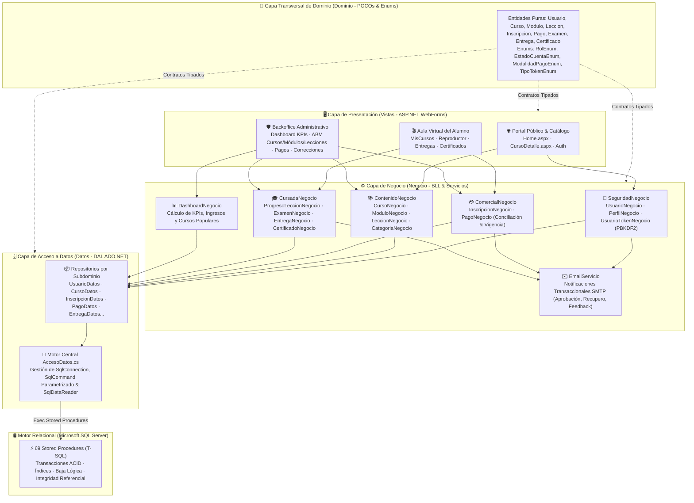
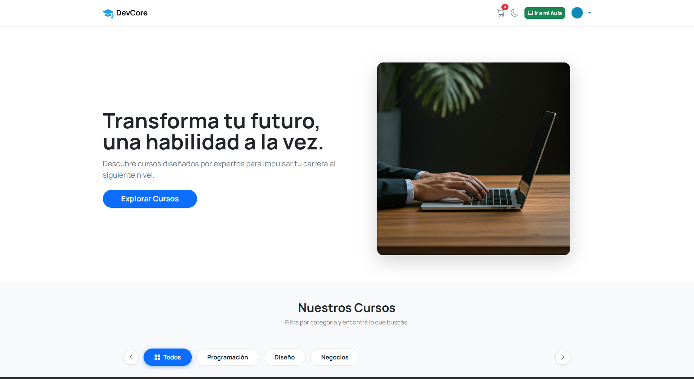
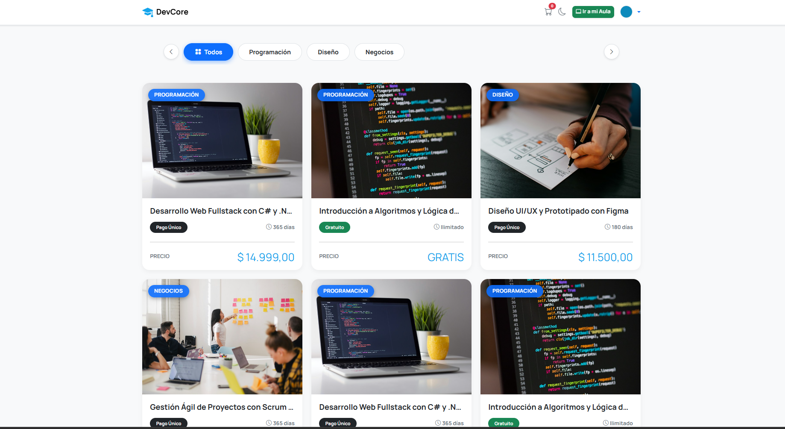
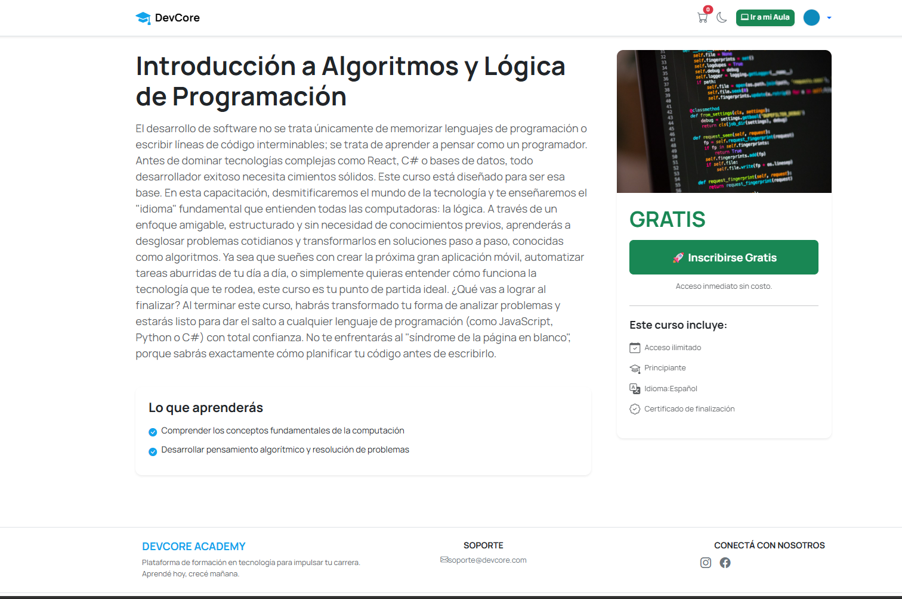
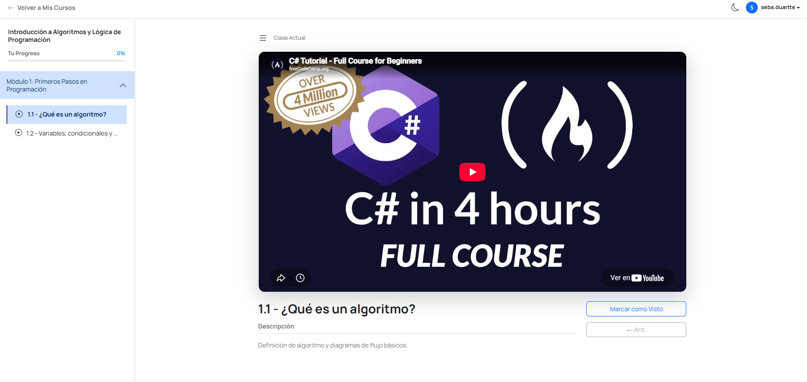
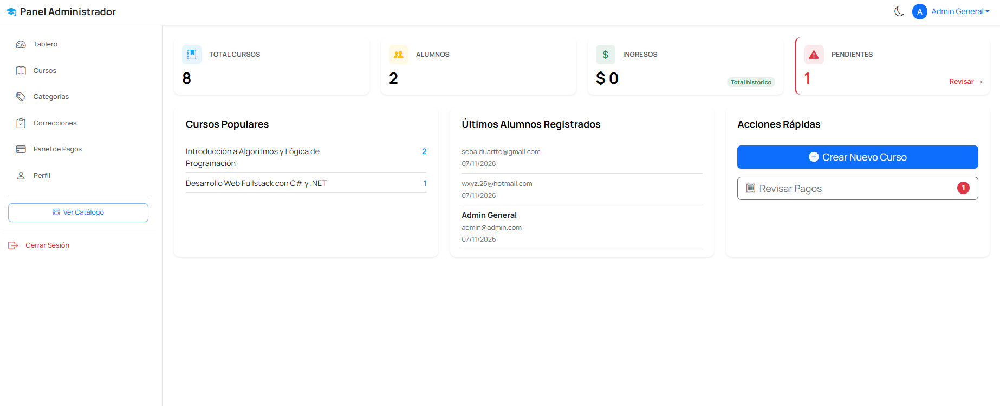
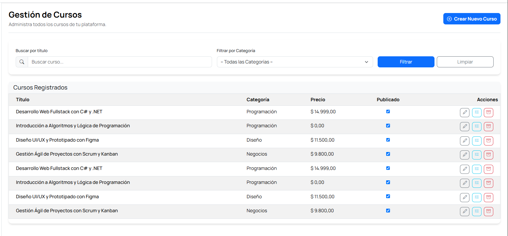
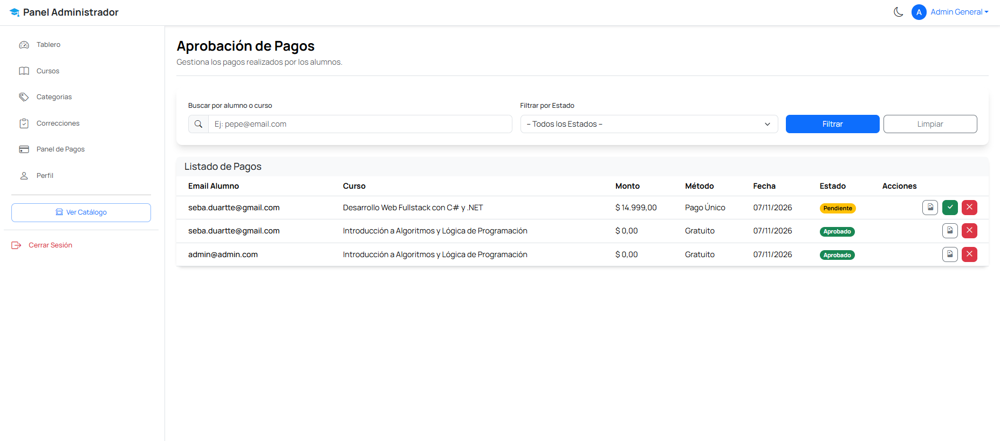

# 🎓 DevCore Academy — Enterprise Learning Management System (LMS) & Backoffice Financiero

> **Plataforma integral de educación online (LMS) diseñada bajo arquitectura empresarial en 4 capas (N-Tier) con .NET Framework 4.8, C#, persistencia de alto rendimiento mediante ADO.NET y 69 Stored Procedures en SQL Server, seguridad criptográfica PBKDF2 y ciclo completo de comercialización, cursado multimedia, evaluación docente y certificación.**

[](https://dotnet.microsoft.com/)
[](https://learn.microsoft.com/en-us/dotnet/csharp/)
[](https://dotnet.microsoft.com/apps/aspnet)
[](https://learn.microsoft.com/en-us/dotnet/framework/data/adonet/)
[-CC292B?style=for-the-badge&logo=microsoftsqlserver&logoColor=white)](https://www.microsoft.com/sql-server)
[](https://getbootstrap.com/)
[-0A66C2?style=for-the-badge)](#%EF%B8%8F-2-arquitectura-t%C3%A9cnica-y-flujo-de-datos-n-tier-4-capas)

---

## 📌 1. El Problema y la Solución

### El Problema
Las instituciones educativas y academias técnicas suelen enfrentar una desconexión crítica entre la **gestión comercial/financiera** (cobros, auditoría de comprobantes de transferencia, vencimientos de acceso) y el **seguimiento académico** (progreso real por lección, entregas de exámenes prácticos, devoluciones docentes y emisión verificable de certificados).

### La Solución
**DevCore Academy** unifica la operación académica y administrativa en una plataforma monolítica modular de alta cohesión dividida en dos entornos aislados por rol:

1. **Portal del Estudiante y Aula Virtual Interactiva:** Catálogo público con filtrado reactivo por categoría, inscripción inmediata en cursos gratuitos o mediante carga de comprobante en cursos de pago único, reproductor de clases en video con tracking porcentual de avance por módulo/lección, módulo de subida de entregas prácticas y descarga de certificados de aprobación.
2. **Backoffice Administrativo y Financiero:** Panel ejecutivo de métricas (KPIs de recaudación histórica, matrículas activas, cursos más demandados y pagos pendientes de auditoría), ABM jerárquico en 3 niveles (`Curso` ➔ `Módulo` ➔ `Lección` + `Objetivos` + `Material Descargable`), bandeja de conciliación de pagos con aprobación/rechazo en 1 clic y módulo de corrección de exámenes con feedback pedagógico y notificación automática por correo electrónico (`SMTP`).

---

## 🏗️ 2. Arquitectura Técnica y Flujo de Datos (N-Tier 4 Capas)

El sistema implementa una **Arquitectura en 4 Capas Estrictas (N-Tier)** particionada internamente por **Subdominios Funcionales** (`Comercial`, `Contenido`, `Cursada`, `Dashboard`, `Seguridad` y `Servicios`), garantizando bajo acoplamiento y cero consultas SQL embebidas en el código de aplicación:

### Diagrama de Arquitectura y Capas de Dominio



---

### Organización por Subdominios y Modelo Relacional

Cada proyecto de la solución (`Dominio.csproj`, `Datos.csproj`, `Negocio.csproj`, `Vistas.csproj`) refleja de forma simétrica los 5 contextos del negocio:

| Subdominio | Entidades Clave (`Dominio`) | Responsabilidad Técnica y Reglas de Negocio |
| :--- | :--- | :--- |
| **1. Seguridad e Identidad** | `Usuario`, `Perfil`, `Rol`, `EstadoCuenta`, `UsuarioToken` | Autenticación con `FormsAuthentication`, hashing criptográfico de contraseñas, gestión de perfiles y emisión de tokens temporales (`TipoTokenEnum`) para activación de cuenta y reseteo de clave. |
| **2. Contenido Académico** | `Categoria`, `Curso`, `CursoObjetivo`, `Modulo`, `Leccion` | Estructura curricular jerárquica (`1:N`), gestión de objetivos de aprendizaje, ordenamiento secuencial de módulos/lecciones, recursos adjuntos (`ArchivoLeccionDatos`) y control de publicación. |
| **3. Gestión Comercial** | `Inscripcion`, `Pago`, `ModalidadPagoEnum` | Ciclo de vida de matriculaciones: activación instantánea para cursos `Gratuito` o flujo de auditoría documental (`Pendiente` ➔ `Aprobado` / `Rechazado`) para cursos de `Pago Único`, con cálculo de expiración por días de acceso (`DuracionDias`). |
| **4. Cursada y Evaluación** | `ProgresoLeccion`, `Examen`, `Entrega`, `Certificado` | Registro atómico de lecciones vistas por alumno, cálculo porcentual de avance en tiempo real, recepción de entregas de examen, calificación docente con devolución escrita y habilitación condicional del certificado final. |
| **5. Telemetría & Backoffice** | `DashboardVista`, `MetricasDashboard`, `CursoPopular`, `UsuarioReciente` | Agregación en base de datos para reportar facturación total aprobada, alumnos activos, cola de pagos por auditar y ranking de cursos con mayor tracción. |

---

## ⚡ 3. Características Técnicas Destacadas

### 1. Capa de Persistencia 100% basada en Stored Procedures (69 Procedimientos T-SQL)
El acceso a datos prescinde de consultas dinámicas concatenadas y centraliza toda la comunicación con **Microsoft SQL Server** a través del wrapper [`AccesoDatos.cs`](./Datos/AccesoDatos.cs):
* **Prevención Absoluta de SQL Injection (SQLi):** Todas las operaciones utilizan `SqlCommand` con `CommandType.StoredProcedure` e inyección estricta de parámetros tipados (`setearParametro`).
* **Optimización de Planes de Ejecución:** Las 69 rutinas almacenadas en [`PlataformaCursosDB.sql`](./PlataformaCursosDB.sql) encapsulan joins complejos, cálculos de progreso académico, validaciones transaccionales y agregaciones del dashboard directamente en el motor de base de datos.
* **Gestión Determinista de Recursos:** Apertura controlada de conexiones y liberación garantizada de `SqlDataReader` y `SqlConnection` en bloques `finally`.

### 2. Seguridad Criptográfica (PBKDF2), Tokens de Verificación y RBAC
* **Hashing de Contraseñas con Salt Criptográfico:** Implementación de `PasswordHasher` (`Microsoft.AspNet.Identity`) basado en el estándar **PBKDF2 con HMAC-SHA1** (salt aleatorio de 128 bits, subkey de 256 bits y 1,000 iteraciones), impidiendo ataques de diccionario o *rainbow tables*.
* **Control de Acceso Basado en Roles (RBAC):** Segregación de rutas y MasterPages entre `Administrador` y `Participante` mediante tickets cifrados de *FormsAuthentication* y validación de sesión en servidor en cada ciclo de vida de página (`Page_Load`).
* **Integridad Histórica y Baja Lógica:** Ningún registro crítico (cursos con alumnos históricos, pagos auditados o usuarios) se destruye físicamente; el sistema opera con borrado lógico (`EstaActivo = 0`) manteniendo intacta la trazabilidad financiera y académica.

### 3. Motor de Conciliación de Pagos y Automatización por Correo (`EmailServicio`)
* **Flujo Financiero Auditado:** Cuando un estudiante adquiere un curso arancelado, adjunta el comprobante digital y la inscripción queda en estado `Pendiente`. Desde el Backoffice, el administrador inspecciona el archivo adjunto y aprueba o rechaza la operación en un clic.
* **Notificaciones Transaccionales SMTP:** El servicio desacoplado [`EmailServicio.cs`](./Negocio/Servicios/EmailServicio.cs) dispara correos HTML automatizados ante eventos clave del dominio: bienvenida/verificación de cuenta, recuperación de contraseña mediante token, confirmación de pago aprobado con habilitación de aula y notificación de calificación de examen.

---

## 📸 4. Demostración Visual de la Plataforma

### 👨‍🎓 A. Experiencia del Estudiante (Portal Público y Aula Virtual)

#### 1. Landing Page y Catálogo Dinámico Multicriterio
> *Presentación institucional y grilla de cursos con filtrado en tiempo real por categorías temáticas (`Programación`, `Diseño`, `Negocios`), modalidad de acceso (`Pago Único` vs `Gratuito`), vigencia en días y precio.*

| 1️⃣ Hero Principal & Categorías | 2️⃣ Catálogo Dinámico de Cursos |
| :---: | :---: |
|  |  |

#### 2. Ficha Técnica del Curso & Aula Virtual Interactiva
> *A la izquierda, vista de detalle con propuesta pedagógica, objetivos y llamado a la acción según modalidad; a la derecha, el Aula Virtual con índice modular colapsable, barra de progreso porcentual, reproductor de video embebido y marcado secuencial de clases vistas.*

| 1️⃣ Ficha Técnica y Objetivos del Curso | 2️⃣ Aula Virtual y Reproductor Multimedia |
| :---: | :---: |
|  |  |

---

### 🛡️ B. Experiencia Administrativa (Backoffice Ejecutivo y Financiero)

#### 3. Dashboard de Métricas y Control Operativo
> *Panel de mando con indicadores clave en tiempo real (Total de Cursos, Alumnos Activos, Ingresos Históricos y Alertas de Pagos Pendientes), ranking de cursos más populares, últimos alumnos registrados y accesos rápidos de gestión.*



#### 4. Gestión Integral de Cursos (ABM Jerárquico) y Auditoría de Pagos
> *Administración del catálogo con filtros combinados y estado de publicación instantáneo, junto a la bandeja financiera para inspección de comprobantes, aprobación de matrículas y rechazo de operaciones.*

| 1️⃣ ABM Jerárquico de Cursos, Módulos y Lecciones | 2️⃣ Bandeja de Conciliación y Aprobación de Pagos |
| :---: | :---: |
|  |  |

---

## 🛠️ 5. Stack Tecnológico

| Capa Arquitectónica | Tecnologías e Implementación |
| :--- | :--- |
| **Lenguaje & Runtime** | C# 10 sobre .NET Framework 4.8 |
| **Presentación Web (UI)** | ASP.NET WebForms (`.aspx`, MasterPages modulares, Server Controls), Bootstrap 5.3, CSS3 Custom Properties, JavaScript ES6+ y SweetAlert2 |
| **Lógica de Negocio (BLL)** | Librería de clases C# (`Negocio.csproj`) particionada por subdominios + `Microsoft.AspNet.Identity` (PBKDF2) |
| **Acceso a Datos (DAL)** | ADO.NET puro (`SqlConnection`, `SqlCommand`, `SqlDataReader`) centralizado en `AccesoDatos.cs` |
| **Base de Datos Relacional** | Microsoft SQL Server (T-SQL, 69 Stored Procedures, Índices B-Tree y Restricciones de Integridad) |
| **Servicios de Mensajería** | `System.Net.Mail` (`SmtpClient` con soporte TLS/SSL para notificaciones transaccionales) |

---

## ⚙️ 6. Puesta en Marcha en Entorno Local

### Prerrequisitos
* **Visual Studio 2022** (con la carga de trabajo *ASP.NET y desarrollo web* / *.NET Framework 4.8*).
* **Microsoft SQL Server** (`SQLEXPRESS`, `LocalDB` o `Developer Edition`).
* **SQL Server Management Studio (SSMS)** o extensión SQL Server en VS Code.

### Paso 1: Clonar el Repositorio
```bash
git clone https://github.com/SebastianDte/Plataforma-cursos-dotnet.git
cd Plataforma-cursos-dotnet
```

### Paso 2: Inicializar la Base de Datos y los Stored Procedures
1. Abrí **SQL Server Management Studio (SSMS)** y conectate a tu instancia local.
2. Ejecutá el script de esquema y procedimientos completo:
   * 📄 [`PlataformaCursosDB.sql`](./PlataformaCursosDB.sql) *(Crea la base de datos `PlataformaCursosDB`, todas las tablas relacionales, restricciones, los 69 Stored Procedures y las semillas de roles/estados/admin).*
3. *(Opcional)* Ejecutá el script de datos de prueba para poblar el catálogo con cursos, módulos y lecciones listas para usar:
   * 📄 [`DemoCursos.sql`](./DemoCursos.sql)

### Paso 3: Verificar la Cadena de Conexión y Ejecutar
1. En [`Vistas/Web.config`](./Vistas/Web.config), verificá que el nodo `connectionStrings` apunte a tu instancia de SQL Server:
   ```xml
   <connectionStrings>
     <add name="ConexionDB" 
          connectionString="server=.\SQLEXPRESS; database=PlataformaCursosDB; integrated security=true;" 
          providerName="System.Data.SqlClient" />
   </connectionStrings>
   ```
2. Abrí la solución [`DevCoreAcademy.sln`](./DevCoreAcademy.sln) en Visual Studio 2022 y presioná **`F5`** (IIS Express).

### 🔑 Credenciales de Prueba Preconfiguradas

| Rol en el Sistema | Correo Electrónico | Contraseña | Alcance de Permisos |
| :--- | :--- | :--- | :--- |
| **Administrador** | `admin@admin.com` | `admin123` | Acceso total al Backoffice, KPIs financieros, ABM de cursos/módulos/lecciones, aprobación de pagos y corrección de entregas. |
| **Estudiante** | *Registro libre desde la web* | *Mínimo 8 caracteres* | Exploración del catálogo, inscripción a cursos gratuitos/pagos, acceso al Aula Virtual, entregas y certificados. |

---

## 👨‍💻 7. Autor y Contacto

Desarrollado y arquitecturado por **Sebastián Duarte**  
*Backend .NET & AI Solutions Architect*

* 🌐 **Sitio Web & Portfolio:** [https://www.sebastianduarte.com](https://www.sebastianduarte.com)
* 💼 **LinkedIn:** [https://www.linkedin.com/in/sebastiandte](https://www.linkedin.com/in/sebastiandte)
* ✉️ **Correo Electrónico:** [contacto@sebastianduarte.com](mailto:contacto@sebastianduarte.com)
* 🐙 **GitHub:** [@SebastianDte](https://github.com/SebastianDte)

---
*© 2026 Sebastián Duarte — Todos los derechos reservados.*
